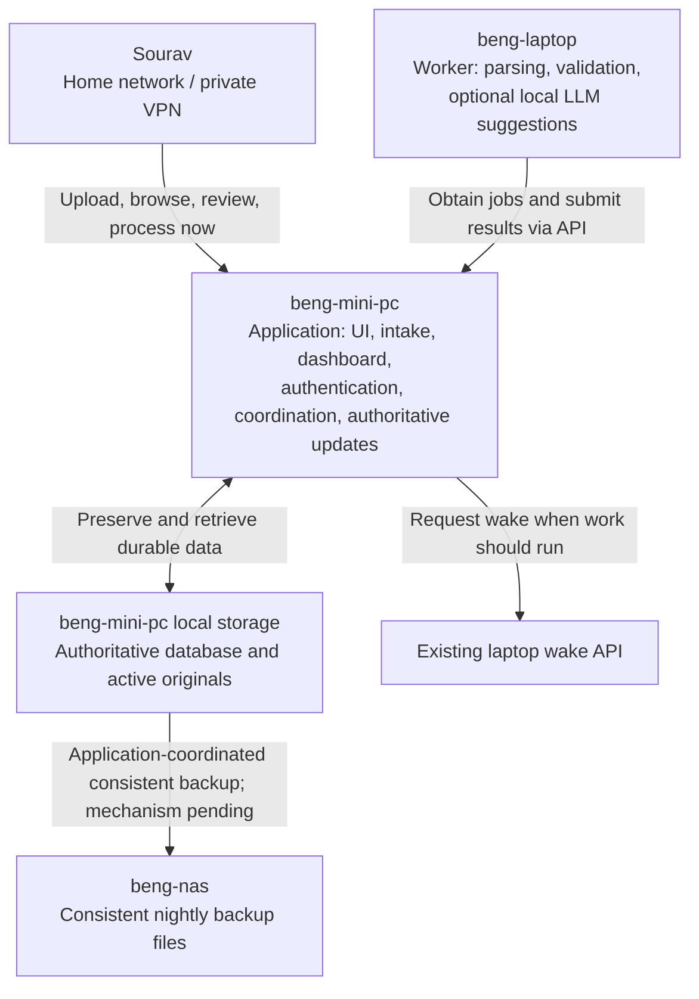

# Beng Document Intelligence System

## High-Level Design and Requirements

**Status:** Agreed product and logical architecture; detailed technical design pending

**Document version:** 0.3

**Updated:** 2026-10-18

**Initial product:** Personal statement import and financial dashboard for Sourav

**Purpose:** Record the agreed initial scope, financial reporting semantics, system responsibilities, and acceptance requirements without inventing sample-dependent parsing rules or unverified infrastructure capabilities.

**Storage revision:** v0.3 supersedes v0.2's NAS-authoritative storage design.
Authoritative state and active originals are local to the mini-PC. The NAS is
for nightly consistent backups; no NAS project database or compute is required.
Historical transaction records stay local; twelve months is a default dashboard
view, not a deletion rule. A dedicated PostgreSQL Docker container and seven successful nightly backup
generations are selected in the [storage decision](.scratch/initial-release-design/issues/06-authoritative-storage-acceptance-backup.md).

## 1. Executive Summary

The initial system imports statements and exports from Sourav's named bank and credit-card accounts, preserves the original files, extracts transactions, and presents a financial overview. The dashboard shows spending, income, cash outgoing, and net cash position over a selected period. Simple transaction-description search supports investigation and links results to their sources.

Initial account coverage is:

- Lloyds Current Account;
- Lloyds Credit;
- Amex Credit;
- Revolut Debit.

Input is manually uploaded text-based PDF, text export, or CSV in explicitly supported formats. There is no initial OCR or general-purpose document parser. Exact formats will be established from representative samples supplied by Sourav before implementation starts.

The three hosts now have these responsibilities:

1. **beng-mini-pc:** one application for UI, intake, dashboard, authentication, and coordination, with authoritative database state and active originals on local storage.
2. **beng-nas:** file backup storage, independent of the live application path. No project database or compute runs here.
3. **beng-laptop:** one worker for statement processing and optional local LLM interpretation, normally activated for batches.

Processing favors deterministic parsing, computation, and validation. A local LLM may suggest interpretations of ambiguous descriptions or financial classifications; it cannot silently change financial facts or settle uncertain classifications. Cloud AI is outside the initial scope.

## 2. Product Direction and Scope

### 2.1 Initial user and experience

Sourav is the sole user for the first few versions. The product will be evaluated and refined before adoption by Swati. Initial access is private, authenticated, and available on the home network and through private VPN access. Use private HTTPS and a single Sourav login through Django authentication; no public exposure or self-service registration. Concrete routing and certificate setup remain to be verified.

The primary experience is a dashboard, rather than a document-search page or conversational interface. Transaction search initially matches the original name/description text. An uploads view exposes preserved sources, processing state, and failures. Review allows correction of extracted information and uncertain classifications.

### 2.2 Initial goals

- Preserve every accepted original before processing.
- Import transactions reliably from the supplied account formats.
- Combine overlapping uploads without silently merging distinct transactions.
- Explain dashboard figures through source transactions and explicit reporting rules.
- Recognize own-account transfers and credit-card repayments without double-counting spending.
- Preserve source evidence, processing history, and manual corrections.
- Keep uploads, existing dashboard data, search, review, and source access independent of laptop availability.
- Batch processing without requiring the laptop to remain awake continuously.
- Keep authoritative state and active originals on mini-PC local storage and make consistent nightly backups to NAS.
- Retain imported transaction history locally; default the dashboard to twelve months without automatic age-based removal.

### 2.3 Deferred scope

The wider vision remains a household service for preserving, finding, and understanding documents. Later versions may add Swati, other document types, photographs and OCR, email ingestion, richer structured search, explicit evidence-linked deep search, detailed spending categories, and budgeting features.

These are future possibilities, not requirements for the initial release. Initial scope also excludes financial advice, cloud AI, automatic currency conversion, arbitrary statement-layout support, separate queue/search services, and a microservice architecture. Queue-size wake triggers and application-controlled laptop sleep are deferred.

## 3. Implementation Prerequisites

**Before implementation starts, ask Sourav for representative input formats for all four accounts.** Planning and infrastructure investigation may continue meanwhile.

Samples must establish the supported layouts and available fields; do not invent column names, account identifiers, date semantics, balance fields, or transaction-matching rules. Sanitized fixtures and their expected results must be agreed before they enter version control.

Sourav will provide the mini-PC persistent-data location and NAS backup destination during implementation. Verify local disk headroom and the intended Docker daemon before provisioning; do not place live database files on the NAS mount.

Read-only inventory verified all three SSH aliases, laptop RTX 2070 Max-Q with 8 GB VRAM and an existing Ollama service, and a reachable controller page with a source-backed wake endpoint. Actual sleep-to-wake behavior, container GPU access, model quality and memory fit remain untested. A roughly 4B model is an example preference, not a selected model. See the [host inventory](.scratch/initial-release-design/research/host-storage-wake-inventory.md).

## 4. Design Principles

1. **Preserve first, interpret later.** Accepted originals remain available regardless of processing outcome.
2. **Deterministic financial facts.** Parse and validate source dates, amounts, currencies, and descriptions without allowing LLM suggestions to replace them silently.
3. **Evidence before aggregation.** Retain the source relationships needed to explain records, matches, corrections, and dashboard figures.
4. **Expose uncertainty.** Missing coverage, unresolved extraction, and ambiguous transfer matches must not appear as complete, final results.
5. **Keep authoritative state independent of the laptop.** Mini-PC local storage owns accepted originals and committed knowledge; recoverable NAS backups protect against mini-PC loss within the agreed backup window.
6. **One owner of authoritative updates.** The mini-PC application validates and commits results; the laptop worker submits results through its API.
7. **Small deployment, clear modules.** Begin with one application and one worker, with internal responsibilities that can be tested through clear interfaces.

## 5. Logical Architecture

Project services will be deployed in Docker containers, including the application,
worker, and dedicated database. Native deployment is an exception only when very
simple and explicitly discussed with Sourav. Existing native infrastructure or
Ollama installation does not select a native deployment for this project.

The application stack is Django with a Python laptop worker. The browser UI is
custom responsive Django-rendered pages with small JavaScript modules and
Chart.js; it is not a separate React application. See the
[stack decision](docs/adr/0002-python-application-and-rendered-ui.md).

Development is on the Mac, with as much appropriate local testing as possible.
At meaningful milestones, perform full end-to-end checks in the actual deployment
environment. Sourav selected Docker Desktop as the Mac test runtime for isolated
PostgreSQL and file storage; installation, versions and readiness are not yet
verified. Real-host acceptance remains necessary for GPU, wake, persistence and
recovery.

The worker downloads assigned originals through the authenticated mini-PC application API (concrete endpoint schemas remain to be specified); it does not require NAS reads or independently update authoritative records. The database is a dedicated PostgreSQL Docker container on the mini-PC with local persistent data; exact image/version and paths remain to be selected. The NAS receives backup files, not live database files.

The standalone Excalidraw, SVG, and PNG diagrams currently in the workspace were produced for v0.1. They are historical illustrations and do not yet represent this revised worker/API ownership or initial product scope. This document's embedded diagram is the current logical view.

### 5.1 Mini-PC application

Owns:

- private authenticated access and the user interface;
- named accounts and user-selected account assignment during upload;
- upload validation, original preservation, and durable tracking;
- durable job coordination, nightly scheduling, Process now, and wake/readiness status;
- validation and authoritative publication of worker results;
- protection of manual corrections against stale processing results;
- dashboard computations over committed records, simple search, review, and original access.

The application does not perform model inference or depend on the laptop for ordinary retrieval. Scheduler and job coordination are application responsibilities; a separate queue service is not required initially.

### 5.2 Mini-PC authoritative storage and NAS backups

Mini-PC local storage holds active originals and authoritative account, transaction, provenance, correction, processing, and lifecycle data. Persistent data outlives individual containers. Laptop loss cannot remove this data; mini-PC disk loss requires recovery from a successful backup. Derived indexes may be rebuilt.

An upload is accepted only after its original and tracking record are durably preserved locally. NAS downtime delays backups and exposes a visible backup error; it does not block normal application use or switch the authority location. The local file/record acceptance and restart-recovery mechanisms remain to be designed and tested. Local storage full/unavailable must produce an explicit intake error.

Nightly backups include originals and authoritative records/corrections as a
consistent recovery set. Keep the seven most recent successful generations;
retire the oldest only after a new backup completes successfully. Interrupted
copies are not successful generations. Show last successful backup and failures. Disk failure
can lose changes since that successful backup; failed runs may extend the window
beyond one day. A failed backup never authorizes removal of local data.

The initial version retains imported historical transaction records locally.
Twelve months is a default dashboard view, not physical deletion. Active source
files remain local and are copied to NAS; any later archival of old originals
needs a separate retrieval/retention decision. Database export/copy mechanics
and restoration commands remain to be specified and tested against the agreed
consistent-recovery and seven-generation policy. Host placement
does not establish power-loss safety; local storage flush behavior still needs
verification.

### 5.3 Laptop worker

Use a separate replaceable machine credential scoped to job claims, assigned
source downloads, progress and result submission. It grants neither the user's
login privileges nor direct database access. Controller authentication and
concrete private transport integration still require verification.

Obtains jobs through the application API, reads source material through an agreed mechanism, performs format-specific extraction and validation, optionally obtains local LLM suggestions, and returns results to the application.

One upload is one processing job, and the initial laptop worker runs one job at
a time. It downloads the assigned original through an authenticated application
endpoint and returns structured results via API; it has no shared-folder mounts
or database credentials. Temporary laptop files are removed after processing,
with cleanup after crashes as well. One upload's failure does not prevent other
eligible uploads from being processed.

The local LLM is limited to advisory classification of rows left unresolved by
deterministic rules (spending, income, transfer, refund or unknown). Supply
extracted facts and bounded relevant context; validate structured allowed values,
source references and a short explanation, with abstention permitted. Require
explicit user confirmation before a suggestion changes financial classification.
It cannot parse/repair amounts, dates or balances; categories and chat remain
outside initial scope.

Optional advisory failure does not fail a validated financial import. Publish
validated deterministic results with unresolved review/advice-unavailable status;
retry advice separately with bounds rather than reimporting financial facts.
This refines the earlier general inference-retry rule: core processing failures
retain the three-attempt policy, optional advisory failures degrade to review.

Choose the exact local model/runtime using a bounded evaluation on the actual
laptop during implementation before enabling advice. Compare labelled-case
correctness, abstention/coverage, latency and memory against the rules-only
baseline. No cloud fallback or model-fit claim follows from this plan.

Initial enablement requires at least 90% correct non-abstained suggestions and
at least 50% coverage on 50 independently labelled held-out cases, including
legitimate unknowns. Report actual counts and per-class failures; abstention
is not an answered prediction. Do not tune prompts on the hold-out. This is a
small pilot gate, not proof of general reliability; confirmation remains required.

Evaluate at most two documented local quantized candidates initially. Target
100 unresolved transactions in ten minutes of warm inference on the actual
laptop, reporting cold-load time separately, with stable operation on its 8 GB
GPU hardware and no out-of-memory failures. Bound execution and degrade to
manual review on failure. The exact model/runtime remains unselected until this
benchmark passes. If no candidate meets the gates, keep advice disabled and
allow the deterministic application to ship with manual review. Carry the
[bounded evaluation prerequisite](.scratch/initial-release-design/issues/11-local-interpretation-and-model-evaluation.md)
into implementation tickets before enabling advice.

A supported CSV or other fully deterministic import may require no LLM call. After draining available work, the worker becomes idle. Existing laptop power management owns sleep; the application does not force the machine to sleep while it may be in use.

## 6. Information Model

This is a logical model, not a committed database schema.

| Concept | Meaning and required relationships |
| --- | --- |
| Named account | User-recognizable account, provider, account type, and source identifiers where available; examples are the four initial accounts. |
| Upload | Preserved original PDF/text/CSV, selected account, source filename, receipt context, processing history, and status. A statement and an overlapping export can be separate uploads. |
| Source entry | A transaction or balance observation as represented in a particular upload, retaining the supplied values and a source locator. |
| Transaction | Logical account-specific transaction linked to one or more supporting source entries when overlap is reliably established. |
| Transfer link | Relationship between separate transactions on different tracked accounts representing a money movement. It is not a duplicate-transaction merge. |
| Balance observation | Source-supported balance and its date/meaning, used as an anchor for historical balance reconstruction. |
| Interpretation | Deterministic classification or separately identified LLM suggestion, with supporting evidence and uncertainty. |
| Correction | User-confirmed replacement or classification retaining the previous extracted value, source relationship, and history. |
| Processing attempt | Job/result identity, processing version/context, outcome, issues, and association with the source and published results. |

### 6.1 Financial fields and provenance

Retain source dates, amounts, currency, description, and supplied original-currency amounts. Preserve purchase date separately when supplied alongside a posting date. Retain date meaning when only one date exists.

Normalize GBP ledger amounts to integer pence with explicit source sign/CR and
currency evidence, without binary floating point or silent rounding of malformed
values. Use the supported format's money-in/out or debit/credit representation;
retain both transaction and posting dates where provided. Exact parser/schema
and matching evidence implementations remain specification work. See the
[import contract and examples](.scratch/initial-release-design/research/import-contract-examples.md).

Every derived fact or correction must be traceable to its upload and supporting text, row, or page location where the format permits. The exact locator scheme will follow the samples.

### 6.2 Overlap versus transfers

Detect identical files and avoid duplicate transaction effects on retries. Different uploads may cover the same transactions; merge logical records only when account-specific evidence is sufficiently reliable, retaining every supporting source link. Identical date/amount/description values alone must not silently collapse potentially distinct payments.

Own-account transfers retain the transaction on each account and link the two entries for reporting. This applies to card repayments, transfers between current/debit accounts, and Revolut funding where applicable. Separately charged fees remain spending.

Ambiguous duplicates, transfers, and repayments remain reviewable. Matching rules and acceptable evidence will be established from samples, not guessed.

### 6.3 Corrections and reprocessing

Show source material alongside extracted information where practical. Preserve original extracted values and user corrections. Reprocessing must retain corrections, flag conflicting new results, and prevent stale results from replacing newer user-confirmed information.

## 7. Dashboard and Reporting Semantics

### 7.1 Period and dates

The dashboard has a time-period selector. Use booking/posting date for reporting and balance history when supplied. If a supported format supplies only one date, use it and retain its meaning. Refunds affect their posting period; do not silently restate an earlier month's spending.

### 7.2 Metrics

| Metric | Meaning |
| --- | --- |
| Spending | Purchases, fees, and interest charged, reduced by refunds; also includes Revolut GBP converted into foreign currency under the chosen GBP-only convention. Excludes card repayments and other tracked own-account transfers. |
| Income | Identified income such as salary and interest received; excludes own transfers and refunds. An incoming entry is not automatically confirmed income. |
| Cash outgoing | Cash leaving current/debit accounts for external payments, including card repayments; excludes transfers between tracked own accounts. |
| Net cash position | Tracked current/debit and savings account balances minus outstanding credit-card debt, shown as a history graph with incomplete history visible. |

Spending and cash outgoing describe different events and timing; they are not interchangeable or additive dashboard components. For example, a card purchase in September is September spending, while its repayment from the current account in October contributes to October cash outgoing, not October spending.

A repayment from Lloyds Current to Lloyds Credit or Amex retains both entries but does not create additional spending or income. Although a card repayment is an own-account transfer, its current-account cash movement is included in the explicitly defined cash outgoing metric; this is an intentional reporting exception.

Cash withdrawals count as spending and cash outgoing when posted, without a
cash-wallet ledger. Explicit fee waivers reverse fee spending; returned payments
reverse their original classification when evidence identifies it, otherwise
request review rather than infer income. Cash outgoing remains gross outgoing;
an incoming reversal is not a second outgoing or newly earned income.

### 7.3 Currency and completeness

Preserve each recorded currency and any separately supplied original-currency amount. No automatic FX conversion. Totals and net cash histories remain separate by currency; do not invent one converted portfolio total.

For Revolut, import only personal GBP and savings GBP sections; ignore joint
accounts, non-GBP accounts and crypto sections. Count a posted conversion out of GBP into another currency
as spending and GBP cash outgoing. Do not also track the foreign-currency leg or
subsequent purchases from that excluded balance. This measures spending at the
GBP conversion, not necessarily at the date of the later purchase. Excluded
foreign/crypto balances do not form part of tracked net cash and their absence
is not a GBP coverage gap. The excluded joint account is also outside tracked
net cash. Preserve the unchanged source PDF. A conversion back into GBP records
an incoming cash movement and reduces spending in its posting period, like a
refund; it is not newly earned income. An incoming GBP amount is not
automatically income. Include source-supported savings balance observations in net cash and explicit
interest receipts in income. An interest-only export does not establish savings
principal movements or a complete daily balance history; do not invent these.
Flag unexplained balance changes and request fuller evidence when necessary.
Keep GBP-side movements to/from excluded joint, crypto and investment accounts
without importing those accounts. Balances reflect posted movements; unclear
spending/income classifications require review and make affected totals
provisional. The explicit foreign-currency conversion rules above still apply.

Balance history requires known balance anchors and sufficient transactions. Missing periods or missing balances are shown as incomplete coverage, not fabricated zero balances. The direction/sign conventions for card debt and balances must be validated against the supplied formats.

Unresolved amount/currency records are excluded from affected totals and remain reviewable. Uncertain transfer or financial classification makes affected totals visibly provisional. Show pending uploads and coverage issues so committed data is not mistaken for a complete view of all activity.

### 7.4 Search and supporting views

Initial transaction search is simple text matching against original names/descriptions, with results linked to supporting uploads. Advanced filters, conversational search, and semantic/deep search are deferred.

Retain the last-twelve-month dashboard default, with month/year/custom period
selection. One selected period controls the metrics and net-cash graph. Clicking
spending, income or cash outgoing opens its contributing transaction list while
retaining the period context; inclusions, exclusions and provisional items remain
explainable through source evidence.

Show balances and card debt by named account with dates and coverage/provisional
indicators linked to their issues. Do not connect unsupported graph gaps as
verified daily history. Sparse savings evidence may appear as dated points;
missing account evidence must not imply a complete combined balance.

The uploads view exposes originals, account association, processing/partial
states and problems. Review handles one issue at a time with original page/row
evidence, extracted values and the proposed correction or match, including its
before/after effect. Require explicit save/confirm/reject. Allow reverting a
correction to the source-derived value with validation and retained history;
defer bulk approval. Existing correction precedence and stale-result protection
still apply.

Support dashboard, upload, simple search and review on both phone and desktop,
using stacked forms/cards on phones rather than requiring wide tables. No
separate mobile app is required. Exact visual design/components and accessible
browser implementation remain later work.

## 8. Primary Flows and Lifecycle

### 8.1 Upload and acceptance

1. Sourav chooses a named account and uploads a supported source file. Remember the last account selection. A combined Revolut original may populate both personal GBP and savings GBP; confirm section-to-account mapping on first import and reuse only while source identities remain consistent. One upload remains one processing job; no manual PDF split is required.
2. Validate intake and check source account identifiers when available; flag mismatches rather than silently assigning another account.
3. Durably preserve the original and its tracking record on mini-PC local storage before reporting acceptance.
4. Show the upload immediately with pending processing status.
5. Make it available to the next batch, or to Process now.

Reject unreadable/corrupt, password-protected and image-only inputs with a clear
reason; initially cap each file at 20 MiB and PDFs at 100 pages. No OCR/password
workflow. Readable accepted originals with unsupported layouts remain preserved
and explicitly flagged; never report successful transaction import. Text/CSV
layouts require explicit support and fixtures, not a generic parser assumption.

### 8.2 Batch processing and wake-up

1. A configurable nightly batch checks for pending work. With no work, it need not wake the laptop.
2. If processing should run and the worker is unavailable, request wake through the existing API and expose readiness progress.
3. The worker obtains jobs through the application API and processes supported formats.
4. It returns deterministic results, validation issues, source evidence, and any separately identified LLM suggestions.
5. The application validates and publishes each upload's processed result as one consistent update, including review flags.
6. The worker drains available work and becomes idle; normal laptop power management handles sleep.

Process now uses the same queue and processing rules. It releases all currently
waiting uploads, requests wake if needed, and shows queued, waking, processing,
or failure status asynchronously. It does not interrupt a running job or create
duplicate work on repeated clicks. Pending uploads are eligible only after the
nightly batch or Process now releases them; an already-awake laptop is not itself
permission to process waiting uploads.

Processing runs daily at 21:00 Europe/London; independent consistent backups run
at 03:00 in the same timezone. Both are configurable. After mini-PC downtime,
perform one catch-up run per missed schedule, rather than replaying each missed
day. Backups use committed state without waiting indefinitely for laptop jobs.

Allow ten minutes from a wake request to application-worker readiness, then show
unavailability and retain queued work for manual retry or the next nightly batch.
Do not continuously send wake requests. This is a startup deadline, not a job
execution timeout, and needs actual-host validation. Readiness probes,
heartbeat/expiry timings, retry delays and execution timeouts remain to be
specified and calibrated. The recovery rules below are agreed.

Agreed recovery behavior: a worker renews a temporary job claim; missed renewals
eventually permit retry, while expired attempts cannot replace newer results.
Stop processing when lost ownership is detected. Temporary processing failures
have at most three attempts with increasing delays, then visible failure/manual
retry. Unsupported formats and repeatable validation failures go directly to
review. Wake checks do not consume processing attempts. Intervals, delays,
execution timeouts and the proposed ten-minute readiness limit require calibration.

Stable attempt identities make repeated identical result submissions safe: a
commit whose success response was lost returns the prior success on resubmission,
without applying financial effects twice. Conflicting submissions for the same
attempt are rejected. This is not a promise that computation runs exactly once.

### 8.3 Dashboard during work or failure

Serve the last committed data while new imports or reprocessing run. Show pending work and review issues. Failed or interrupted processing preserves originals and previously published data and supports retry. Do not expose partially committed processing artifacts as a completed import.

If transaction arithmetic or statement reconciliation fails for a supported
account section, preserve its original/evidence and previous financial view.
Independently valid sections may publish in the same consistent upload update,
with a visible partial outcome and section-specific problems. Do not invent
transactions/amounts to reconcile a failure. Interest-only savings evidence has
the completeness limits described above; ignored sections do not cause failure.

Machine-derived values and user corrections remain separate. When a result
arrives after a user edit, publication preserves confirmed values and flags
contradictions. If reprocessing changes transaction identities enough that a
correction cannot be associated safely, retain the prior published view and
request review rather than lose the correction.

While actively processing, maintain a bounded expiring keep-awake lease using
the existing controller's create/extend/release actions. Renew only while work
is legitimately active and release the application's lease when finished;
worker failure leaves a bounded lease that expires. Do not release unrelated
user leases or force sleep. The controller has an eight-hour lifetime ceiling
per lease; cap-aware renewal and failure handling require integration tests.
Keep-awake leases are distinct from job ownership claims. See the
[verified interface](.scratch/initial-release-design/research/keep-awake-contract.md).

### 8.4 Operational visibility and service recovery

Keep failures visible in the application until resolved, alongside last successful
processing and backup times. External notifications are deferred; Sourav must
open the application to notice failures. Operational logs contain job identities,
timings, stages and sanitized errors, excluding statement contents, transaction
descriptions, account identifiers and credentials. Financial evidence remains
in the protected application.

Project containers restart automatically after crashes or host reboots; work
recovers through the agreed ownership, retry and publication rules. Upgrades,
migrations and restores remain deliberate operations requiring approval when
affecting existing data. Automatic restart does not establish data durability
or successful recovery; these need actual-host acceptance tests.

### 8.5 State dimensions

Keep processing progress and review requirements conceptually separate: a completed processing result may still contain uncertain financial classifications.

| Dimension | Logical states or conditions |
| --- | --- |
| Preservation | Accepted only after durable original and tracking record; otherwise intake error. |
| Processing | Pending, processing, completed, partial/failed, reprocessing. |
| Worker readiness | Queued, waking, ready/processing, unavailable/failed as relevant to the request. |
| Review | Clear or needs review, with explicit extraction, account, match, classification, or correction-conflict issues. |
| Reporting | Committed view, pending additions, provisional figures, and incomplete coverage. |

These are observable requirements, not a finalized enum or state-transition schema. Recovery rules must ensure interrupted jobs remain identifiable and retryable without duplicate effects.

## 9. Functional Requirements

| ID | Requirement |
| --- | --- |
| FR-ING-01 | Manually accept explicitly supported text-based PDF, text, and CSV inputs for the four named accounts, preserving accepted originals. |
| FR-ING-02 | Require named account selection, remember the last selection, and expose detectable account mismatches. |
| FR-ING-03 | Report acceptance only after durable local preservation of the original and tracking record; expose local storage failures. NAS backup failure does not block intake. |
| FR-PRO-01 | Extract and validate transactions and available statement/balance information deterministically for supplied formats. |
| FR-PRO-02 | Keep local LLM suggestions separate from source facts and user-confirmed values; use no cloud AI. |
| FR-PRO-03 | Publish consistent per-upload results; preserve previous committed data on processing failure or interruption. |
| FR-MAT-01 | Detect identical-file/overlap effects conservatively, preserve evidence, and avoid silently merging distinct transactions. |
| FR-MAT-02 | Link supported own-account transfers and card repayments without collapsing their separate account entries; flag ambiguous matches. |
| FR-DASH-01 | Provide period-selected spending, income, cash outgoing, and net cash position history using section 7 semantics. |
| FR-DASH-02 | Keep currencies separate, exclude unresolved monetary facts from affected totals, and expose provisional figures and coverage gaps. |
| FR-RET-01 | Search original transaction names/descriptions with simple text matching and provide access to supporting originals. |
| FR-REV-01 | Support review and corrections while retaining source values, history, and precedence across reprocessing. |
| FR-CTL-01 | Provide configurable nightly batching and asynchronous Process now using the same durable job rules. |
| FR-CTL-02 | Wake only when work should run, expose readiness/failure, and prevent duplicate concurrent effects. |
| FR-CTL-03 | Route authoritative updates through the mini-PC application API; the worker must not independently edit authoritative records. |
| FR-SEC-01 | Provide private authenticated access for Sourav on home/VPN access paths. |
| FR-OPS-01 | Keep seven successful nightly consistent NAS backups of local originals and authoritative records/corrections; show last success/failures, retire the oldest only after a successful new generation, and never delete local data on backup failure. |

## 10. Non-Functional and Operational Requirements

- **NFR-AVL-01:** Normal upload, committed dashboard, search, review, and active-original access must not require the laptop or NAS. Mini-PC application/local-storage availability is a dependency.
- **NFR-DUR-01:** Losing or replacing the laptop must not lose accepted originals or committed records/corrections.
- **NFR-INT-01:** Retry, overlapping imports, stale jobs, and reprocessing must not silently duplicate financial effects or overwrite user corrections.
- **NFR-EXP-01:** Financial facts, source evidence, interpretations, corrections, uncertainty, and coverage limitations must remain distinguishable.
- **NFR-PRI-01:** Keep document data and model processing on the user's machines; keep credentials and real private financial fixtures out of version control.
- **NFR-OPS-01:** Make a simple consistent nightly backup from mini-PC local storage to NAS, without elaborate backup infrastructure. Show last successful backup/failures and verify basic restoration. Keep seven successful nightly generations, scheduled at 03:00 Europe/London. Database-copy mechanics remain to be specified and verified.
- **NFR-OPS-02:** Sourav accepts possible loss of imports/corrections since the last successful backup if mini-PC data is lost; backup failures can extend this beyond a day. A NAS backup does not eliminate NAS power-loss or whole-site failure risk. Additional off-site backup infrastructure is not an initial requirement.
- **NFR-PER-01:** Serve dashboard/search from prepared data without repeating model inference. With 100,000 transactions over up to ten years and one active user, target p95 at most two seconds from submission to usable visible dashboard/period-update or text-search result on the actual mini-PC over home LAN. Run at least 30 repetitions per representative journey after warm-up and report cold first load separately. Record dataset/query/browser/network/runtime conditions. This latency gate excludes file transfer, ingestion/inference and VPN transit; those still require functional checks. Actual performance remains unmeasured.

## 11. Acceptance Scenarios

These define observable acceptance, not a completed test suite. Sourav approved
the [public test interfaces and release gates](.scratch/initial-release-design/issues/12-public-test-interfaces-and-release-acceptance.md):
statement interpretation/reporting, application upload/job/review/report interfaces
with real PostgreSQL and isolated files, browser journeys, and infrastructure
adapters/operational commands with actual-host acceptance. Each interface's
catch/miss limits are recorded in that decision. Build one failing behavioral
test and its minimum implementation at a time; avoid private-method tests and
DB side-channel assertions.

Use independent synthetic/sanitized expected results; verify all four actual
source formats against private originals outside Git for release. Preserve known
coverage gaps. Mac tests and controlled failures do not establish physical host
behavior. Required real-host milestones include home/VPN authentication,
phone/desktop journeys, restart/stale-result/correction recovery, wake/readiness/
lease lifecycle, backup during processing, NAS failure and isolated restore of
originals/evidence/corrections. Use fault simulation, not deliberate power cuts;
restart recovery does not prove physical power-loss durability. Advice requires
its separate model benchmark, otherwise manual review remains available.
Required checks must pass before deployed-release claims; record untested items
and failures explicitly. These design approvals do not authorize deployment or
Git pushes.

1. Upload a supported source for a selected account; acceptance means its original and tracking record survive service restart on the durable data plane.
2. With the laptop unavailable, upload new work and continue browsing committed dashboard data, searching transactions, reviewing records, and opening originals.
3. A NAS outage leaves local uploads, dashboard, search, review and active-original access available while backup failure is visible. A local storage failure never produces a false successful acceptance.
4. Process representative samples for all four accounts and compare transactions, dates, amounts, currencies, and balances against independently established expected results.
5. Retry an import or process overlapping sources without duplicate transaction effects; retain multiple source links where a reliable match exists. Distinct identical-looking payments remain distinct when evidence cannot justify merging them.
6. A card purchase followed by a Lloyds-to-card repayment contributes spending once. Both repayment entries remain traceable; the current-account movement contributes to cash outgoing under its posting period.
7. An own-account transfer, including supported Revolut funding, does not create spending or income; a separately charged fee remains spending.
8. A refund reduces spending in its posting period. Income classification does not mistake own transfers or refunds for earnings.
9. Balance history reflects known anchors and source transactions, subtracts card liabilities, separates currencies, and visibly marks missing coverage rather than inventing zero balances.
10. Unresolved amounts/currencies are excluded from affected totals; ambiguous classifications/matches leave totals visibly provisional and reviewable.
11. Correct a value or classification, reprocess its source, and demonstrate that the correction remains authoritative and conflicting new results are flagged.
12. Interrupt processing and retry: originals and the last committed view remain intact; no partial result appears completed and no duplicate effects are introduced.
13. Trigger Process now repeatedly while the laptop is asleep; observe asynchronous progress through the agreed wake/readiness mechanism without duplicate concurrent work.
14. Produce a consistent nightly NAS backup containing local originals and authoritative records/corrections; restore and verify their source relationships. Show last successful backup and failed attempts; a failed backup must not delete local data. Historical transaction records remain available beyond the default twelve-month dashboard view.
15. Verify private authentication/access and that real private statements or credentials have not entered version control.

Actual hardware, wake, storage, recovery, and local-model behavior require real-environment evidence. Unit tests and source inspection alone do not establish them.

## 12. Open Design Work and Explicit TODOs

| Area | Remaining work |
| --- | --- |
| User-supplied formats | All four text PDFs supplied and inspected; see [inventory](.scratch/initial-release-design/research/statement-format-inventory.md). Establish synthetic/sanitized fixtures and independently reviewed expected results; card cycles do not provide complete August coverage. Revolut scope is personal GBP and savings GBP only, excluding joint/non-GBP/crypto sections; specify savings coverage from the interest-only export. |
| Input contract | Implement agreed rejection/20 MiB/100-page limits, supported layouts, text/CSV interaction and identity-checked account mapping; build fixtures and validate extraction. |
| Financial rules | Implement and test agreed normalization, cash/reversal and conservative duplicate/transfer contracts; establish source-supported matching evidence and overlap/year-boundary fixtures. |
| Data and persistence | PostgreSQL Docker on mini-PC local storage is selected. Specify image/version, paths, exact numeric precision/schema, balance reconstruction, original/record recovery and publication mechanisms. Verify local SSD flush/power-loss behavior before asserting durable acceptance. |
| Worker interface | Source-file access, worker authentication, job claim/expiry, result versioning, stale-result protection, idempotency, retries, restart recovery. |
| Laptop integration | Inspect existing wake API, readiness and timeout behavior, verify reported GPU, benchmark candidate local model/runtime; preserve existing sleep ownership. |
| Operations | 21:00 processing/03:00 backup Europe/London and ten-minute readiness deadline agreed; specify probes, observability, concrete images/versions, explicit mini-PC Docker endpoint, and consistent backup/recovery implementation. Mac development/local testing then real-host milestone E2E is agreed; exact local runtime setup remains open. |
| Persistent paths | Sourav supplies mini-PC local data and NAS backup destinations during implementation; verify disk capacity and intended Docker daemon. |
| UI and access | Dashboard/review interactions and phone/desktop scope agreed; implement and verify visual design, accessibility, evidence navigation and private HTTPS/Django login deployment with home/VPN integration. |
| Performance and testing | Public test interfaces, 100,000-transaction/ten-year envelope, p95 latency conditions and real-host gates agreed. Build and run the tests; record actual performance, failures and release evidence. |
| Project workflow | Configured in `AGENTS.md` and `docs/agents/`: local Markdown specs/tickets, default triage roles, and single-context domain docs. Local commits are allowed as needed; pushes require milestone completion and explicit approval; no PR required. |

Detailed planning may proceed while samples are pending. Do not silently turn an open question into an implementation assumption.

## 13. Architecture Decision Summary

| Agreed decision | Rationale |
| --- | --- |
| Begin with one user and four supplied account formats | Establish useful, reliable behavior without general-purpose intake complexity. |
| Dashboard first, simple description search | Focus initial value on understanding the user's financial position and transactions. |
| Separate spending, income, outgoing, and net cash position | Avoid misleading totals across card purchases, repayments, own transfers, and reporting periods. |
| Preserve originals and source entries independently of interpretations | Permit audit, review, correction, and reprocessing without losing evidence. |
| Deterministic facts, advisory local LLM only | Constrain financial errors and reserve model work for useful interpretation. |
| One mini-PC application owns authoritative writes | Centralize validation, correction precedence, and consistent publication. |
| Laptop worker behind the application job/result API | Keep compute optional while durable state and normal use remain independent. |
| Nightly batches plus asynchronous Process now | Balance delayed processing with user-requested immediacy without requiring continuous laptop uptime. |
| Mini-PC local PostgreSQL Docker and active originals; seven nightly NAS recovery sets | Remove NAS from live database/compute; keep normal use available during backup outages with an explicit recovery window. See [ADR](docs/adr/0001-local-authority-and-nas-backups.md). |
| Retain historical transaction records; twelve-month default view | Avoid archive/restore complexity and preserve cross-period evidence; no automatic age-based purge initially. |
| Explicit uncertainty, currency separation, and coverage gaps | Avoid implying financial precision or completeness unsupported by inputs. |

## 14. Glossary

Use the canonical domain definitions in [GLOSSARY.md](GLOSSARY.md). The host
responsibilities and storage ownership are defined in section 5; financial
reporting rules are in section 7. A reporting period is not a retention boundary.
